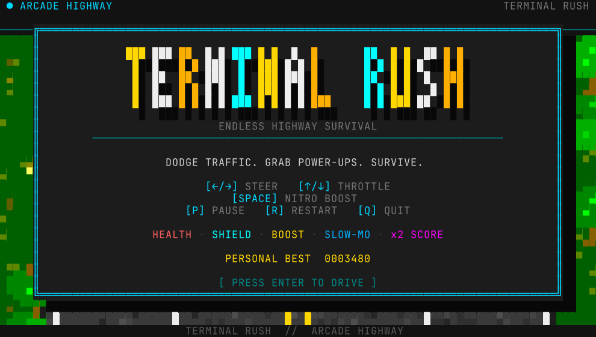
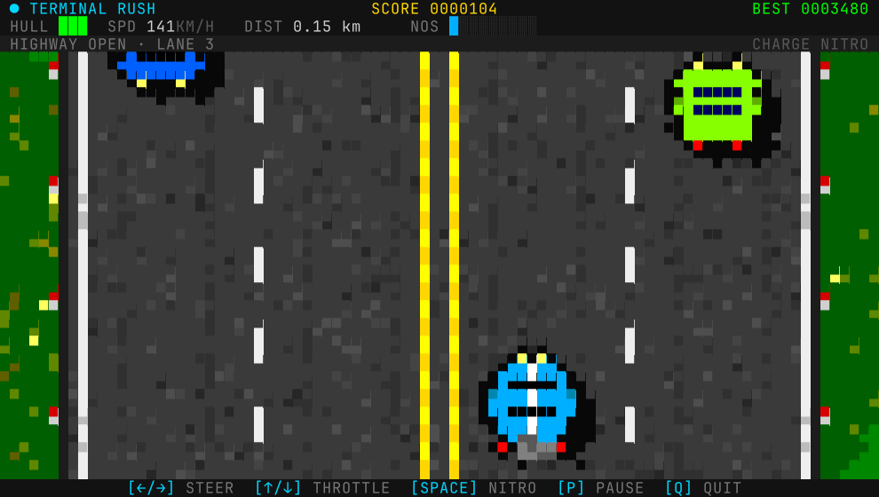
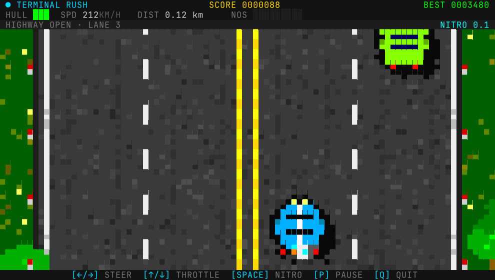
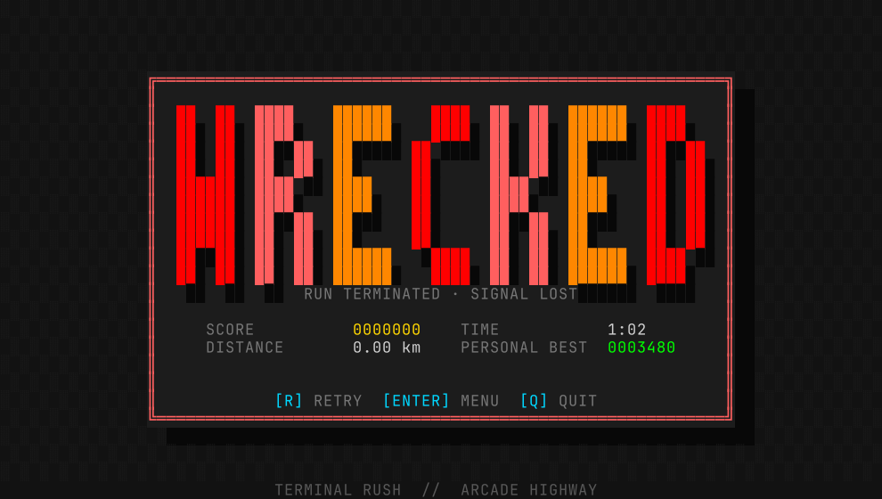
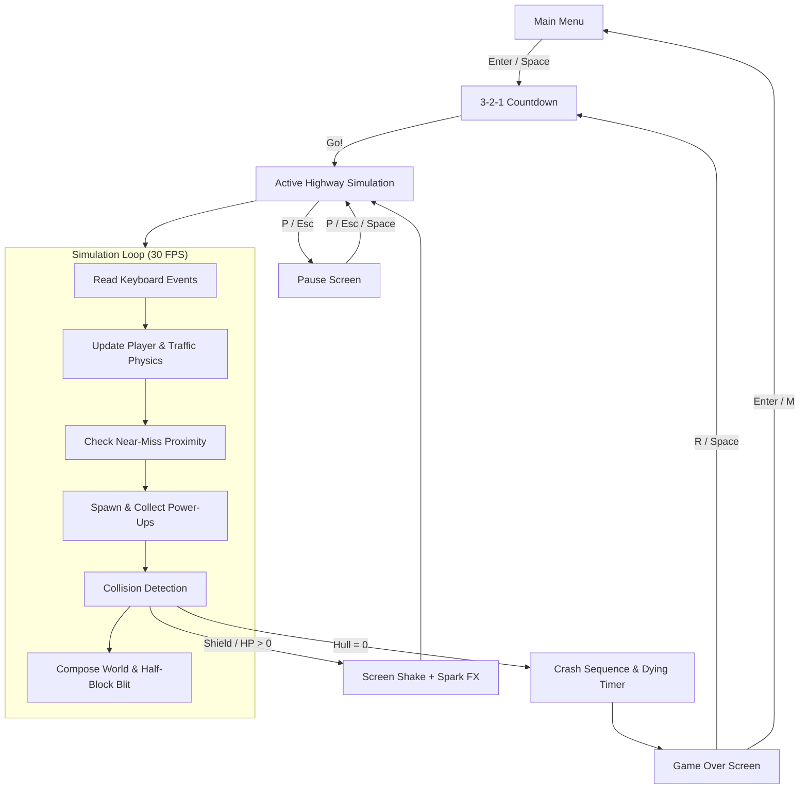
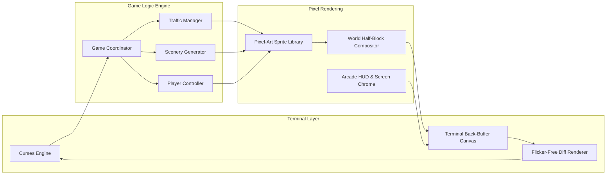
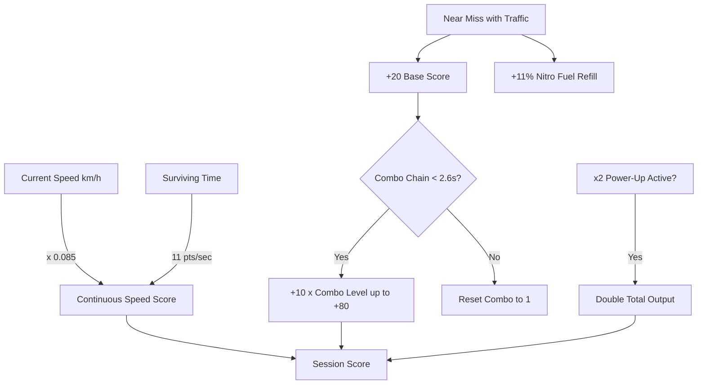

# terminal-car 🏎️

> **Endless retro arcade highway survival, played entirely in your terminal.**  
> Pure Python 3 & standard library `curses` — zero external dependencies, 30 FPS sub-cell half-block graphics, and responsive arcade controls.


<p align="center">
  
  
</p>
<p align="center">
  
  
</p>

---

## ⚡ Highlights

- 🏎️ **4-Lane Bidirectional Highway**: Oncoming traffic blazing down the left lanes, slower cruisers pacing the right lanes.
- 🚦 **Diverse Traffic & AI Chassis**: 7 vehicle body models (**sedan**, **hatchback**, **sports car**, **van**, **taxi**, **heavy truck**, **bus**) generated across 15 retro xterm colour palettes.
- 🔥 **Nitro & Near-Miss Combos**: Weave through narrow gaps between vehicles to trigger **NEAR MISS** alerts, build combo score multipliers, and rapidly refill your Nitro tank.
- 🎁 **5 Collectible Power-Ups**:
  - 💖 **Health**: Restores 1 Hull hitpoint.
  - 🛡️ **Shield**: Absorbs a single vehicle collision.
  - ⚡ **Boost**: Instant turbo speed boost.
  - ⏳ **Slow-Mo**: Dilates time, slowing down traffic for surgical maneuvers.
  - ✖️ **x2 Score**: Doubles all survival distance and speed points.
- 🎨 **Sub-Cell Pixel Engine**: Uses Unicode half-blocks (`▀`, `▄`, `█`) to double vertical rendering resolution, producing crisp 30 FPS pixel art without flicker.
- 🌲 **Living Roadside Scenery**: Parallax pines, round trees, roadside shrubs, rocks, and tufts of grass dynamically scroll and scale with your terminal width.
- 💥 **Visual Impact & Screen FX**: Spark collisions, particle exhaust fumes, camera screen-shake, damage flash alerts, and a glowing retro arcade HUD.
- 💾 **Persistent Stats & High Scores**: Saves your personal best score, total distance, near-miss tally, and survival time to standard XDG data storage (`~/.local/share/terminal-rush/stats.json`).
- 📦 **Zero External Dependencies**: Pure Python standard library (`curses`). No pip installs, no native binary compilation required.

---

## 🚀 Installation

After running the installer on any platform, simply typing **`car`** in your terminal starts the game!

### Linux & macOS (One Line)

```bash
curl -fsSL https://raw.githubusercontent.com/Abdulhadi446/terminal-car/main/install.sh | bash
```

Or clone and run the installer locally:

```bash
git clone https://github.com/Abdulhadi446/terminal-car.git
cd terminal-car
./install.sh            # installs into ~/.local/bin/car
```

#### Installer Options

- **Default (`--user`)**: Installs executable into `~/.local/bin/car` and creates a desktop entry.
- **System-wide (`--system`)**: Installs into `/usr/local/bin/car` (requires sudo permissions):
  ```bash
  sudo ./install.sh --system
  ```
- **Custom directory (`--prefix`)**:
  ```bash
  ./install.sh --prefix "$HOME/.bin"
  ```

> [!TIP]
> The Linux installer also creates a desktop entry in `~/.local/share/applications/terminal-car.desktop`, allowing you to launch **Terminal Rush** directly from your application launcher (Rofi, Wofi, GNOME, KDE, Omarchy, etc.).

---

### Windows (PowerShell, One Line)

```powershell
irm https://raw.githubusercontent.com/Abdulhadi446/terminal-car/main/install.ps1 | iex
```

Or clone and install locally:

```powershell
git clone https://github.com/Abdulhadi446/terminal-car.git
cd terminal-car
Set-ExecutionPolicy -Scope CurrentUser -ExecutionPolicy RemoteSigned -Force
.\install.ps1
```

> [!NOTE]
> Standard Windows Python does not ship with `curses`. Run `pip install windows-curses`, or run the game seamlessly inside **WSL** (Windows Subsystem for Linux).
> The Windows installer automatically generates a Start Menu shortcut under *Terminal Rush*.

---

### Quick Run Without Installing (All Platforms)

```bash
git clone https://github.com/Abdulhadi446/terminal-car.git
cd terminal-car
python3 play.py
```

Or run directly as a module:

```bash
python3 -m terminal_car
```

---

## 🎮 Controls

| Key | Alternative | Action |
|:---:|:---:|:---|
| <kbd>←</kbd> | <kbd>A</kbd> | Steer left (switch lane) |
| <kbd>→</kbd> | <kbd>D</kbd> | Steer right (switch lane) |
| <kbd>↑</kbd> | <kbd>W</kbd> | Accelerate / Increase throttle |
| <kbd>↓</kbd> | <kbd>S</kbd> | Brake / Decrease throttle |
| <kbd>Space</kbd> | — | **Nitro Boost** (requires 40% charge) / Skip countdown |
| <kbd>P</kbd> | <kbd>Esc</kbd> | Pause / Resume game |
| <kbd>R</kbd> | — | Quick restart run |
| <kbd>M</kbd> | <kbd>Enter</kbd> | Return to main menu (from pause or game over) |
| <kbd>Q</kbd> | <kbd>Ctrl+C</kbd> | Quit to terminal |

---

## 🖥️ Platform & Terminal Compatibility

| Platform | Support | Notes |
|:---|:---:|:---|
| **Linux** (Arch, Ubuntu, Fedora, Debian, etc.) |  Native | Zero dependencies (`curses` built-in) |
| **macOS** (Terminal.app, iTerm2, Ghostty) |  Native | Python 3.8+ required |
| **Windows via WSL** |  Native | Recommended way on Windows |
| **Windows Native (CMD / PowerShell)** |  Supported | Requires `pip install windows-curses` |
| **BSD** (FreeBSD, OpenBSD) |  Native | Standard Python 3 + ncurses |

### Tested Terminals
- Alacritty, Kitty, Foot, Ghostty, WezTerm
- GNOME Terminal, Konsole, XFCE Terminal
- tmux & screen multiplexers
- Windows Terminal (WSL & native)

*Minimum terminal size: **54 columns × 18 rows**. The layout automatically scales up to 160×40+ with double-scale pixel assets.*

---

## 📸 Screenshots

| Title Screen | High-Speed Highway |
|:---:|:---:|
|  |  |

| Nitro Overdrive | Game Over & Stats |
|:---:|:---:|
|  |  |

---

## 🧠 How It Works

### Game Loop & State Flow



---

### Architectural Subsystems



---

### Scoring & Multiplier Mechanics



---

## 📁 Project Structure

```
terminal-car/
├── assets/                  # High-resolution screenshots and demo GIF
│   ├── demo.gif             # Animated gameplay preview
│   ├── game-over.png        # Crash & game over screen
│   ├── gameplay.png         # Action gameplay screenshot
│   ├── nitro.png            # Nitro boost screenshot
│   └── title.png            # Retro arcade title screen
├── terminal_car/            # Core package
│   ├── __init__.py          # Package exports
│   ├── __main__.py          # CLI entry point (`python -m terminal_car`)
│   ├── constants.py         # Physics, tuning constants, 256-color palette
│   ├── entities.py          # Player, traffic cars, powerups, particle classes
│   ├── game.py              # Central simulation lifecycle and scoring logic
│   ├── layout.py            # Responsive terminal math and lane mapping
│   ├── play.py              # Curses loop and input handler
│   ├── scenery.py           # Roadside trees, bushes, flowers, and props
│   ├── screens.py           # HUD, menu, countdown, pause, game-over renderers
│   ├── sprites.py           # Pixel-art ASCII/half-block sprite templates
│   ├── storage.py           # XDG persistent high score storage
│   ├── terminal.py          # Canvas buffer and flicker-free diff renderer
│   ├── traffic.py           # Traffic spawner and obstacle behavior
│   └── utils.py             # Math helpers, interpolation, formatting
├── tests/                   # Automated smoke and unit tests
│   └── test_game.py         # Lifecycle and canvas tests
├── tools/                   # Developer tooling
│   ├── ansi_png.py          # ANSI-to-PNG renderer for headless snapshots
│   └── generate_assets.py   # Automated screenshot and GIF generator
├── install.sh               # Unix / macOS one-line installer (`car`)
├── install.ps1              # Windows PowerShell installer (`car.cmd`)
├── play.py                  # Root convenience script (`python play.py`)
├── .gitignore               # Git exclusions
├── LICENSE                  # MIT License
└── README.md                # Documentation & guide
```

---

## ⚙️ Tuning & Customization

All game parameters are cleanly decoupled in [`terminal_car/constants.py`](file:///home/abdulhadi/Projects/terminal-car/terminal_car/constants.py). You can easily fine-tune vehicle physics and mechanics:

```python
# Speed & Scroll progression
BASE_SCROLL = 8.2          # Starting scroll rate
MAX_SCROLL = 13.6          # Top scroll rate at max difficulty
SCROLL_RAMP_SECONDS = 165.0# Time to reach peak speed

# Player Vitality & Nitro
PLAYER_MAX_HEALTH = 3      # Maximum hull hitpoints
NITRO_MAX = 100.0          # Max nitro capacity
NITRO_COST = 40.0         # Nitro required per boost
NITRO_REGEN = 3.2          # Passive nitro recharge per second
NEAR_MISS_NITRO = 11.0     # Nitro rewarded per near-miss

# Near-Miss Bonuses
NEAR_MISS_BASE = 20        # Points for initial near miss
NEAR_MISS_STEP = 10        # Incremental combo bonus
NEAR_MISS_MAX = 80         # Maximum single near-miss bonus
NEAR_MISS_CHAIN_WINDOW = 2.6 # Seconds before combo resets
```

---

## 🕹️ CLI Options

| Flag | Argument | Description |
|:---|:---:|:---|
| `--demo` | — | Skip the main menu and watch the autonomous autopilot drive |
| `--seed` | `<int>` | Set a fixed random seed (great for practicing consistent traffic runs) |
| `--version` | — | Display game version information and exit |
| `-h`, `--help` | — | Display help message and options |

```bash
# Watch the autopilot weave through traffic:
car --demo

# Practice on a specific seed:
car --seed 42
```

---

## 📜 License

This project is open-source software licensed under the [MIT License](LICENSE).
Feel free to modify, distribute, and enjoy!
